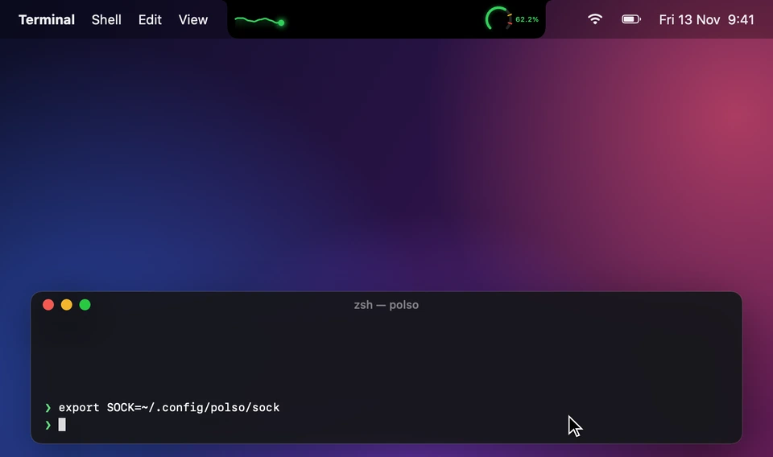
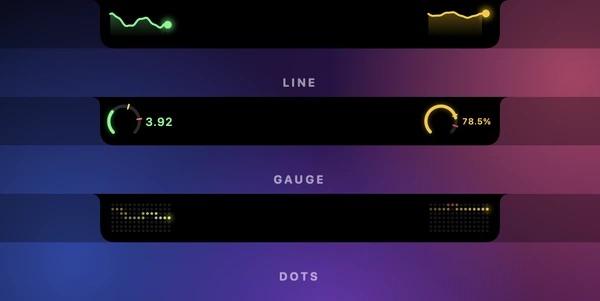
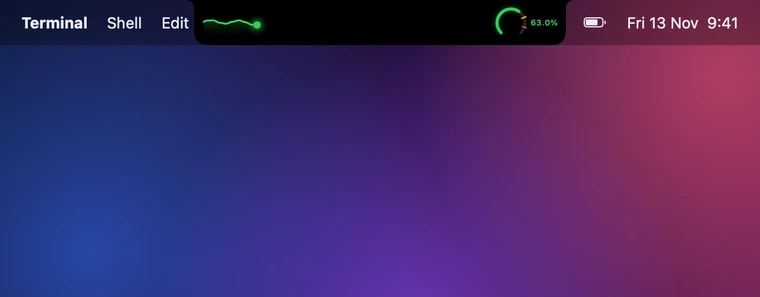

<p align="center">
  
</p>

<h1 align="center">polso</h1>

<p align="center">
  Your MacBook notch as a live meter for anything.<br>
  Feed it numbers, pings and alerts from any script, or let it poll commands and Prometheus.<br>
  <a href="https://hood.github.io/polso/"><b>Docs and live demo →</b></a>
</p>

```sh
just install && just start        # ~/Applications/Polso.app
just push left 42                 # value → left wing
just ping right                   # comet + glow on the right wing
just alert "Deploy failed" crit   # banner
just snapshot                     # render every state to ./snapshots
```

## Wings

Each side of the notch is a meter with its own style, thresholds and units. Values blink in as they
arrive, pings glow the wing they target.

<p align="center"></p>

## Alerts

`info`, `warn` and `crit` banners drop out of the notch with sparks. Alerts arriving close together queue
up, and repeats of the same title bump a counter instead of replaying.

<p align="center"></p>

## Sending data: unix socket

`~/.config/polso/sock` (mode 600) reads newline-delimited JSON. Each line gets `ok` or `error: …` back.

```sh
echo '{"type":"value","slot":"left","value":42}' | nc -U ~/.config/polso/sock
```

| type | fields |
|---|---|
| `value` | `slot` (left/right), `value` (append) or `values` (replace history), optional `label`, `health` (ok/warn/crit/unknown) |
| `ping` | optional `slot` (none = whole notch), optional `color` (ok/warn/crit/info, `#rrggbb`, red…) |
| `alert` | `title`, optional `summary`, `severity` (info/warn/crit, default crit), `count`, `url` (opened from the panel) |

A JSON array sends a batch. Numeric strings are accepted for numbers.

## Pulling data: sources

`sources` in `~/.config/polso/config.json`, editable in Settings › Sources (with a Test button).

```jsonc
{"kind": "exec", "slot": "left", "every": 5, "command": "sysctl -n vm.loadavg | awk '{print $2}'"}
{"kind": "prometheus", "slot": "right", "every": 15, "url": "http://prom:9090", "query": "sum(rate(http_requests_total[5m]))"}
{"kind": "scrape", "slot": "right", "every": 15, "url": "http://localhost:9100/metrics",
 "metric": "http_requests_total", "labels": {"code": "500"}, "rate": true}
```

- `exec`: `sh -c`, stdout is a number (goes to `slot`) or protocol JSON (object, array or one per line), so a
  command can ping and alert too. Optional `timeout` (default 10s).
- `prometheus`: PromQL instant query, first series. Backfills the sparkline with a range query on start.
- `scrape`: Prometheus text exposition. Sums matching series; `rate: true` turns a counter into per-second.

## Config

Deep-merged over defaults and hot-reloaded. Per wing: `title`, `indicator` (line/gauge/dots), `unit`,
`warn`, `crit` (optional), `invert` (low is bad), `max` (gauge scale), `history`, `staleAfter`, `blink`.
Plus `ping` (comet, pulse, color, sound), `alert` (duration, sound, queue) and `expanded` (hover panel).

## README clips

`just film` re-renders `docs/media` from a deterministic timeline (`Sources/Polso/Film.swift`): the real
notch views, driven frame by frame with the same springs and keyframes the app uses live. Needs `ffmpeg`
and `img2webp` (`brew install ffmpeg webp`). `docs/media/hero.mp4` is the same hero clip for sharing.

## Adding an indicator

New file in `Sources/Polso/Indicators/` conforming to `Indicator`, then add it to `Indicators.all`.
